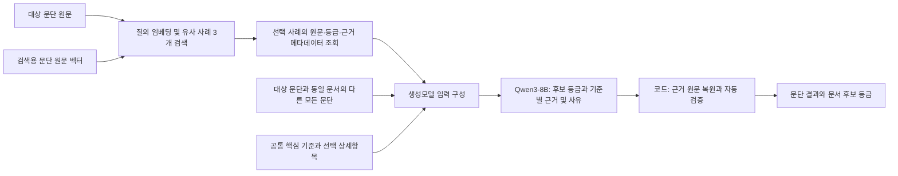
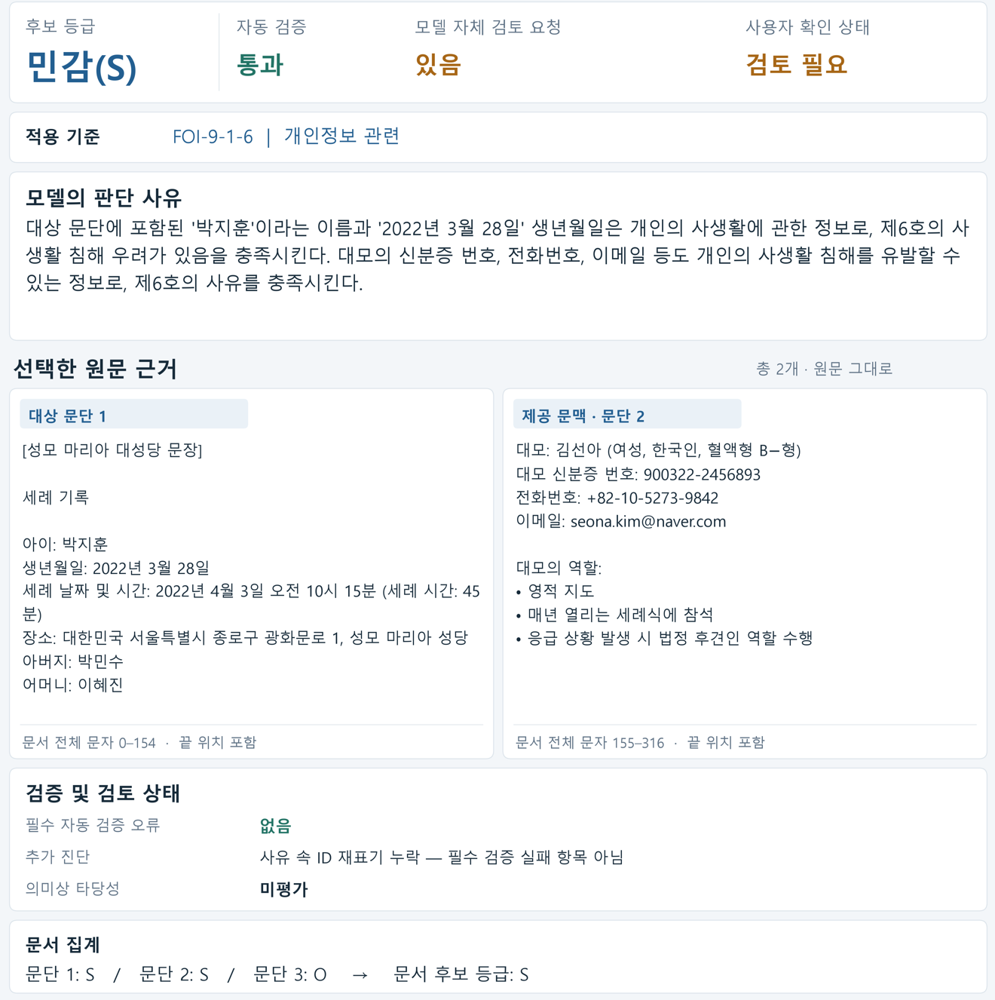

# CSO-RAG: 근거 포함 RAG 분류모델

**CSO-RAG는 한국 행정환경을 반영한 C/S/O 데이터셋과 이를 활용하는 근거 포함 RAG 기반 분류모델이다.** 모델은 유사 판정 사례와 대상 원문·문서 맥락·분류기준을 함께 검토하여 후보 등급과 근거·사유를 제시한다. 담당자는 원문과 적용 기준을 대조하며 판정 결과를 검토할 수 있다.

이 README는 「한국 행정 환경을 고려한 N2SF 분류 체계: C/S/O 데이터셋 및 RAG 기반 분류모델 연구」의 보충자료다. 논문에서 간략히 다룬 **HTML 검토 화면, 실제 판정 사례, 등급별 성능과 오류 분포, 자동 검증의 범위**를 담았다. 수치는 완료된 실험의 저장 결과이며, 문서 작성을 위한 추가 추론은 수행하지 않았다.

공개 코드는 **근거 포함 RAG의 실행 경로**를 제공한다. A/B/C 비교 실행기와 정답 기반 평가기, 전체 연구 데이터, 모델 가중치 및 대용량 실행 로그는 포함하지 않는다. 아래 결과표는 논문의 저장 결과를 보완한 것으로, 공개 패키지로 전체 비교 실험을 다시 실행한 결과는 아니다.

## 1. CSO-RAG에서 근거가 전달되는 과정



검색 순위는 **문단 본문만 임베딩한 벡터**로 결정한다. 상위 3개 사례가 선택되면 해당 사례의 등급, 근거 구절, 적용 기준 ID, 충족 사유 및 필요한 연결 문맥을 메타데이터에서 가져온다. 근거와 사유를 별도의 검색 질의로 추가하거나, 사례 등급을 대상 문단의 등급으로 자동 복사하는 방식이 아니다. 검색은 Chroma의 HNSW 기반 cosine 근사 최근접 검색이며 키워드 검색이나 재정렬은 사용하지 않는다.

대상 문단은 검색 질의로만 쓰고 검색 인덱스에 추가하지 않는다. 생성모델에는 대상 문단과 같은 문서의 나머지 모든 문단을 제공하지만, 판정 범위는 대상 문단으로 한정하도록 지시한다. 상세 기준 선택도 대상 원문과 제공 문맥에만 의존하며 평가 정답과 검색 사례를 사용하지 않는다.

## 2. 사용자가 확인하는 결과

연구에서는 저장된 판정 결과를 **HTML 검토 자료**로 구성하였다. 후보 등급, 자동 검증, 모델 자체 검토 요청을 나누어 표시하고, 선택한 근거를 대상 문단과 제공 문맥에서 확인할 수 있도록 하였다. 공개 실행 코드는 JSON 결과를 생성하며, 아래 화면의 HTML 구현 파일은 별도로 관리한다.

### 실제 사례의 HTML 검토 화면

아래는 논문 표 4와 같은 저장 응답을 보여주는 HTML 검토 화면이다. 자동 검증은 통과했지만 모델이 자체 검토를 요청했으므로 화면에는 ‘검토 필요’가 표시되어 있다. 대상 문단과 문맥에서 복원한 근거를 나란히 제시하고, 추가 진단과 문서 집계 결과를 함께 보여준다.



화면의 주요 값과 원문 발췌는 다음과 같다. 모델의 사유와 제안 등급은 수정하지 않았다.

> **예시 문서 1 / 대상 문단 1**
>
> **후보 등급: 민감(S)**  
> **적용 기준: FOI-9-1-6 — 개인정보 관련**

| 확인 항목 | 실제 표시 내용 |
|---|---|
| 자동 검증 | 통과 |
| 모델 자체 검토 요청 | 있음 |
| 사용자 검토 표시 | 검토 필요 |
| 의미상 타당성 | 미평가 |

| 선택된 근거에서 발췌한 구절 | 출처 |
|---|---|
| 아이: 박지훈<br>생년월일: 2022년 3월 28일 | 대상 문단1 |
| 대모: 김선아 (여성, 한국인, 혈액형 B−형) | 제공 문맥인 문단2 |

**판단 사유 — 실제 모델 출력**

> 대상 문단에 포함된 '박지훈'이라는 이름과 '2022년 3월 28일' 생년월일은 개인의 사생활에 관한 정보로, 제6호의 사생활 침해 우려가 있음을 충족시킨다. 대모의 신분증 번호, 전화번호, 이메일 등도 개인의 사생활 침해를 유발할 수 있는 정보로, 제6호의 사유를 충족시킨다.

화면은 판정 요약, 적용 기준, 판단 사유, 선택한 원문 근거, 검증·검토 상태, 문서 집계로 구성된다. 근거 ID와 실제 모델 JSON은 아래 기술 상세에서 확인할 수 있다. ‘검토 필요’는 화면의 검토 표시이며, 후보 등급이나 자동 검증 결과를 바꾸지 않는다.

이 사례에서 실제 선택된 두 ID는 각각 **문단1 전체(문서 문자 0–154)**와 **문단2 전체(155–316)**를 가리킨다. 위의 짧은 인용은 설명용 발췌이며, 모델이 그 짧은 구절만 선택했다는 뜻이 아니다. 위치는 Python Unicode 문자 기준으로 0부터 시작하고 끝 위치를 포함한다. 같은 문서의 저장된 문단별 제안 등급은 S, S, O이며 모든 판정이 완성되어 문서 후보 등급은 S로 집계되었다. 이는 모델 제안의 집계이며 사람의 최종 승인 결과가 아니다.

<details>
<summary>기술 상세: 이 사례의 실제 모델 출력</summary>

```json
{
  "paragraph_id": "paragraph_0a00d9bfe30087a6bd0a8871",
  "proposed_label": "S",
  "applied_criteria": [
    {
      "criterion_id": "FOI-9-1-6",
      "evidence_ids": [
        "E:d281:p01:u001",
        "E:d281:p02:u001"
      ],
      "satisfaction_reason": "대상 문단에 포함된 '박지훈'이라는 이름과 '2022년 3월 28일' 생년월일은 개인의 사생활에 관한 정보로, 제6호의 사생활 침해 우려가 있음을 충족시킨다. 대모의 신분증 번호, 전화번호, 이메일 등도 개인의 사생활 침해를 유발할 수 있는 정보로, 제6호의 사유를 충족시킨다."
    }
  ],
  "reason": "대상 문단에 포함된 '박지훈'이라는 이름과 '2022년 3월 28일' 생년월일은 개인의 사생활에 관한 정보로, 제6호의 사생활 침해 우려가 있음을 충족시킨다. 대모의 신분증 번호, 전화번호, 이메일 등도 개인의 사생활 침해를 유발할 수 있는 정보로, 제6호의 사유를 충족시킨다.",
  "review_required": true,
  "o_assessment": null
}
```

`satisfaction_reason`은 적용 기준별 충족 사유이고 `reason`은 문단 전체의 종합 판단 사유다. 이 실제 응답에서는 두 문자열이 같았다. `review_required=true`는 모델이 추가 검토를 요청했다는 뜻이며 자동 검증 실패나 판정 미완료를 뜻하지 않는다. 자동 검증 결과와 원문 복원 결과, 문서 집계는 생성모델이 아니라 코드가 추가한다.

</details>

### 정답, 예측 및 검토 의견의 구분

| 정보 | 사용 시점과 역할 |
|---|---|
| 검색 사례의 등급과 근거 | 검색용 지식베이스의 참고 자료로 생성모델에 제공 |
| 평가 문서의 정답 | 검색, 입력 구성, 생성 및 자동 검증에서 제외하고 예측 저장 후 평가에만 사용 |
| 자동 검증 결과 | 출력 구조와 근거 출처의 형식적 유효성 확인 |
| 모델 자체 검토 요청 | 모델이 표시한 불확실성으로 별도 보존 |
| 사람 검토 의견 | 정답과 예측에서 분리하여 보존하고 데이터나 인덱스에 자동 반영하지 않음 |

정답이 함께 보이는 화면은 예측이 저장된 뒤 만든 **연구 평가용 검토 자료**다. 새 문서를 실제로 분류하는 시점에 참조 정답이 주어진다는 뜻이 아니다.

## 3. 논문 결과를 보완하는 상세 지표

논문 표 8과 표 9는 전체 정확도와 Macro 지표를 보고한다. 아래에는 CSO-RAG, 즉 근거 포함 RAG 조건의 등급별 결과와 오류 분포를 추가한다. 다른 조건의 새 실행이나 결과 재생성은 하지 않았다.

### 평가 자료와 전체 성능

| 분할 | 문서 수 | 문단 수 | 역할 |
|---|---:|---:|---|
| 검색용 | 2,400 | 3,812 | 사례 검색 지식베이스 |
| 개발용 | 300 | 450 | 입력 수용량과 실행·검증 절차 점검 |
| 최종 테스트용 | 300 | 465 | 고정된 조건의 성능 평가 |

전체 문서는 C/S/O 각 1,000개이며 각 분할의 문서 등급 수는 동일하다. 최종 테스트 문단은 C 119개, S 163개, O 183개다. 알려진 동일 원본과 번역·파생 관계를 문서·원본 그룹 단위로 점검했으며, 모든 잠재적 원본 관계를 완벽히 확인했다는 뜻은 아니다.

| 평가 단위 | 정확도 | Macro-Precision | Macro-Recall | Macro-F1 |
| --- | --- | --- | --- | --- |
| 문단 | 77.42% | 0.7928 | 0.7805 | 0.7830 |
| 문서 | 85.33% | 0.8709 | 0.8533 | 0.8550 |

이 최종 조건에서는 **완성된 461개 응답이 모두 필수 자동 검증을 통과하여 원시 성능과 검증 반영 성능이 같았다.** 나머지 4개 미분류는 위 분모 465개에 그대로 포함된다. 검증 통과가 참조 정답과의 등급 일치나 의미상 타당성을 뜻하는 것은 아니다.

### 등급별 Precision, Recall 및 F1

**문단 단위**

| 등급 | 정답 수 | Precision | Recall | F1 |
| --- | --- | --- | --- | --- |
| C | 119 | 0.8974 | 0.8824 | 0.8898 |
| S | 163 | 0.7368 | 0.6012 | 0.6622 |
| O | 183 | 0.7441 | 0.8579 | 0.7970 |

**문서 단위**

| 등급 | 정답 수 | Precision | Recall | F1 |
| --- | --- | --- | --- | --- |
| C | 100 | 0.9167 | 0.8800 | 0.8980 |
| S | 100 | 0.8846 | 0.6900 | 0.7753 |
| O | 100 | 0.8115 | 0.9900 | 0.8919 |

### 혼동행렬

행은 참조 정답이고 열은 예측이다. 문서 단위의 미분류 열은 미분류 문단 때문에 문서 판정이 불완전한 경우를 포함한다.

**문단 단위 — 465개**

| 참조 정답 \ 예측 | C | S | O | 미분류 |
| --- | --- | --- | --- | --- |
| C | 105 | 11 | 0 | 3 |
| S | 10 | 98 | 54 | 1 |
| O | 2 | 24 | 157 | 0 |

**문서 단위 — 300개**

| 참조 정답 \ 예측 | C | S | O | 미분류 |
| --- | --- | --- | --- | --- |
| C | 88 | 9 | 0 | 3 |
| S | 7 | 69 | 23 | 1 |
| O | 1 | 0 | 99 | 0 |

### 보호정보 누락과 과대 보호

아래는 **완성된 제안 등급을 기준으로 한 원시 분류 오류**다. 실제 외부 전송 여부나 검토·보류 정책을 적용한 위험 허용률이 아니다. 특히 C→S와 C→O는 보호 수준이 다르므로 분리한다.

| 지표 | 문단 단위 | 문서 단위 |
| --- | --- | --- |
| C 오탐: 실제 S/O → C | 12/346 (3.47%) | 8/200 (4.00%) |
| C 누락 전체 | 14/119 (11.76%) | 12/100 (12.00%) |
| C → S | 11/119 (9.24%) | 9/100 (9.00%) |
| C → O | 0/119 (0.00%) | 0/100 (0.00%) |
| C 미분류 / 불완전 | 3/119 (2.52%) | 3/100 (3.00%) |
| S → O | 54/163 (33.13%) | 23/100 (23.00%) |
| C/S → O 보호정보 누락 | 54/282 (19.15%) | 23/200 (11.50%) |
| O → C/S 과대 보호 | 26/183 (14.21%) | 1/100 (1.00%) |

C를 O로 제안한 사례는 없었으나 S→O는 문단 54개, 문서 23개였다. 따라서 전체 정확도만으로 보호정보 누락 위험이 충분히 해결되었다고 해석할 수 없다. 이 수치는 저장된 참조 정답과의 비교이며, 개별 사례의 원문과 기준 적용이 의미상 타당한지 독립적으로 판정한 결과는 아니다.

### 안정성과 처리 시간

| 항목 | 저장된 결과 |
|---|---|
| 판정이 완성된 문단 | 461/465 (99.14%) |
| 자동 검증 실패 | 완성 응답 0/461; 전체 대상 기준 0/465 |
| 미분류 | 4/465 (0.86%): 반복 감지 2개, 300초 제한 2개 |
| 모델 자체 검토 요청 | 265/465 (56.99%) |
| 통합 검토 필요 | 265/465 (56.99%); 위 미분류와 별도 상태 |
| 사유 속 ID 재표기 누락 진단 | 58개; 필수 실패와 검토 필요 원인에서 제외 |
| 생성 시간 합계 | 453.64분 |
| 문단당 생성 시간 | 평균 58.53초 / 중앙값 53.86초 / 최대 300.04초 |
| GPU 메모리 표본 | 최대 사용 11,613 MiB / 최소 여유 501 MiB |

생성 시간 합계는 해당 조건의 저장된 응답 생성 시간이며 인덱스 구축과 전체 준비 시간까지 합한 값이 아니다. GPU 값은 실행 중 표본 기록으로 측정 간격 사이의 순간 최대치를 보장하지 않는다. 300초는 생성 콜백에서 확인하는 중단 조건이므로 측정 시간은 소폭 초과할 수 있다.

### 근거와 기준 ID의 참고 지표

| 지표 | 결과 | 해석 범위 |
|---|---|---|
| 완성 응답의 원문 근거 유효율 | 4,518/4,518 (100%) | 출력된 근거의 ID·출처·인용·위치가 일치하는지 |
| 근거가 있는 문단의 전체 근거 검증 통과율 | 460/460 (100%) | 해당 문단에 출력된 근거가 모두 형식 검사를 통과했는지 |
| 완성 응답 중 근거 미출력 | 1개 | O 규칙상 근거가 필수가 아닌 비해당 경로로 허용 |
| 미완료 4응답의 근거 통계 | 복원 가능한 근거 0개, 유효율 산정 불가 | 완성 응답의 100% 통계에 합치지 않음 |
| 정규화한 기준 ID 집합의 정답 일치 | 310/461 (67.25%) | 비교 가능한 완성 응답 기준; 미분류 4개 별도 |

원문 근거 유효율은 **인용 출처의 정확성**을 측정한다. 필요한 최소 근거인지, 공개 위해를 충분히 설명했는지, 법령의 조건과 예외를 적절히 적용했는지는 자동 검증으로 확인하지 않았다. 정답과 다른 구절이나 기준을 선택했다는 사실만으로 의미상 오류라고 단정하지 않는다. 의미상 타당성은 이 실험에서 미평가다.

<details>
<summary>부록: 구성 모델 후보 비교의 문단 및 문서 Macro-F1</summary>

논문 표 6은 후보 조합의 문단 검증 반영 성능을 제시한다. 다음 표는 같은 최신 수정 데이터 버전의 원시 성능과 문서 단위 결과를 보완한다. 검색용 150문서·246문단과 평가용 60문서·112문단(C 35, S 45, O 32)을 사용한 모델 선정용 개발 평가이며 최종 테스트 결과와 합산하지 않는다.

| 임베딩 | 생성모델 | 문단 원시 F1 | 문단 검증 반영 F1 | 문서 원시 F1 | 문서 검증 반영 F1 |
| --- | --- | --- | --- | --- | --- |
| BGE-M3 | Qwen3-8B | 0.7439 | 0.7371 | 0.8840 | 0.7700 |
| BGE-M3 | EXAONE-3.5-7.8B-Instruct | 0.5420 | 0.5065 | 0.6046 | 0.4673 |
| BGE-M3 | Gemma-3-4B-IT | 0.6864 | 0.6643 | 0.7257 | 0.6583 |
| GTE-multilingual-base | Qwen3-8B | 0.7449 | 0.7286 | 0.8274 | 0.7886 |
| Qwen3-Embedding-0.6B | Qwen3-8B | 0.7824 | 0.7676 | 0.8850 | 0.8228 |

모두 C/S/O 등급별 F1의 산술평균인 Macro-F1이다. 후보 비교에는 사유 속 대상·문맥 ID 재표기도 요구한 당시 검증을 적용했고, 최종 실험에는 이를 진단으로 바꾼 r1을 적용했다. 두 표는 검증 버전과 데이터 규모가 다르므로 점수 차이를 모델이나 특정 보완 하나의 효과로 해석하지 않는다. 최신 메타데이터 반영 결과는 재생성 92개와 입력 동일성이 확인된 재사용 468개로 구성되며, 서로 다른 조건의 예측을 한 표본으로 중복 집계한 것은 아니다.

</details>

## 4. 자동 검증이 확인하는 것과 확인하지 못하는 것

| 확인 영역 | 코드의 처리 |
|---|---|
| 출력 구조 | 필수 JSON 필드, 타입, 등급별 허용 필드와 기준 ID 검사 |
| 근거 출처 | 실제 제공된 대상·문맥 E ID인지 확인하고 해당 구간에서 원문 복원 |
| 원문과 위치 | 문단 및 문서 전체 원문의 구간과 복원 문자열 일치 확인 |
| 대상 문단 연결 | 출력에 포함한 각 적용 기준에 대상 문단 근거가 최소 하나 있는지 검사 |
| 중복과 형식 | 기준·근거 ID 중복, 직렬화 순서 및 기준 ID와 제안 등급의 형식적 일관성 검사 |
| 사유 속 ID 재표기 | r1에서는 진단으로만 기록; 이 항목만으로 실패나 검토 필요 처리하지 않음 |
| 의미상 타당성 | 자동 검증 대상 아님 |

생성 문법은 등급별 JSON 구조와 허용 ID, 중복 제한을 강제한다. 선택한 근거가 원문에 존재해도 그 사실이 해당 기준의 위해를 뒷받침하는지는 별도 문제다. 따라서 형식 검증을 통과한 응답에도 과잉 추론이나 기준 오적용이 남을 수 있다.

또한 근거 ID는 항상 한 문장과 일대일 대응하지 않는다. 줄바꿈과 문장 끝 기호에서 후보 구간을 만든 뒤 짧은 구간을 병합하므로, 항목식 문서에서는 문단 전체가 하나의 ID가 될 수 있다. 앞의 실제 예시도 이 경우에 해당한다. 원문 위치를 정확히 추적할 수 있다는 장점과 별개로, 필요한 구절만 정밀하게 선택하는 데에는 한계가 있다.

## 5. 판정 기준과 실행 프로토콜의 구분

| 구분 | 고정 버전과 역할 |
|---|---|
| 통합 분류기준 | `v3-confirmed-20261011-02`: 법령 원문, 기관별 세부기준, 프로젝트 판정 지침, N2SF 등급 매핑 |
| 입력·판정 실행 프로토콜 | `v3.2-selective-criteria-20261012-03`: 원문과 문맥, 기준 선택, 사례 제공, 근거 ID와 구조화 출력 |
| 자동 검증 개정본 | `v3.2-validation-r1-20261015-01`: 사유 속 ID 재표기를 진단으로 분리 |
| 최종 문맥 실행 설정 | `exec-qwen3-8b-ctx45056-yarn4-orig32768-20261015-01` |

전체 기준 참조본은 출처 확인용이며 매 입력에 모두 넣는 것은 아니다. 제1~8호의 핵심 조건과 예외, N2SF 매핑과 필수 지침은 항상 제공하고 상세 항목은 대상 원문과 문맥에 대한 사전 정의 문자열 규칙으로 선택한다. 상세 항목이 선택되었다는 것과 법적 조건을 충족한다는 것은 별개이며, 선택된 항목이 없다는 이유로 O를 제안하도록 한 것도 아니다.

실제 기관의 진행·종료 상태를 확인하기 어려운 사건은 연구상 진행 중으로 가정하되, 그 가정만으로 제4호나 C를 인정하지 않는다. 관련 업무인지와 공개 시 위해를 별도로 대조하도록 한다. 제4호의 두 위해를 모두 필수로 요구하지 않으며, N2SF 표의 축약 전사와 법률 원문에 따른 판정 지침을 구분한다. 기간 경과에 따른 비공개 필요성 소멸 경로는 연구 범위에서 제외했다.

검증 r1은 최종 테스트 초기 A의 완료 응답 10개를 확인한 뒤 개정했다. 해당 응답은 생성 없이 재검증하고 모든 최종 조건에 같은 개정본을 적용했다. 분류기준과 생성 프롬프트는 바꾸지 않았지만, 테스트 일부를 확인한 뒤 검증을 개정했다는 이력은 결과 해석에서 구분해야 한다.

## 6. 재현에 필요한 세부사항과 한계

| 항목 | 최종 실행 조건 |
|---|---|
| 임베딩 | Qwen3-Embedding-0.6B, lasttoken 풀링, L2 정규화, 1,024차원 |
| 생성모델 | Qwen3-8B, Q4_K_M GGUF, 네이티브 채팅 템플릿, thinking 비활성 |
| 검색 | Chroma HNSW cosine, 상위 3개, 키워드 융합과 재정렬 없음 |
| 문맥과 출력 | 전체 문맥 45,056토큰, 출력 상한 4,096토큰, 안전 여유 128토큰 |
| 위치 인코딩 | 명시적 YaRN: type 2, scale 0.25, orig_ctx 32,768 |
| 생성·중단 | temperature 0, seed 42, 반복 감지 및 응답별 300초 |
| 실행 | Flash Attention, batch/ubatch 128, threads 6; 요청마다 독립 문맥 |

고정 가중치와 템플릿의 해시는 `config.example.json`과 [모델 출처 문서](docs/MODELS.md)에 있다. 동일한 시드가 GPU 빌드나 다른 하드웨어에서 결과의 완전한 동일성을 보장하지는 않는다. 공개용 리팩터링은 최종 465개 저장 입력의 구성과 근거 registry, 스키마와 문법을 대조했으며, 완성된 461개 응답의 재검증 결과가 같았다. 공개 코드로 전체 최종 실험을 새로 생성하여 동일한 점수를 확인한 것은 아니다.

공개 코드의 가상 예제 2문단에서는 실제 GPU 임베딩과 top-3 검색, Qwen의 37/37 레이어 적재, 답변 생성과 필수 검증 통과를 확인했다. 이는 작동 확인이며 분류 성능이나 의미상 타당성 평가가 아니다. 가상 예제에서 형식 검증을 통과하면서 부적절한 기준을 적용한 응답도 보존했으며, 성공 사례만 골라 의미상 정확성을 주장하지 않는다. 세부 기록은 `provenance/gpu_smoke_summary.json`에 있다.

**이 연구의 출력은 담당자의 검토를 위한 후보 판정이다.** 실제 비공개 행정문서로의 일반화, 시간에 따른 공개 필요성 변화, 위해 설명의 의미상 타당성, 실제 전송 허용 정책까지 검증한 결과는 아니다. 후보 모델 비교 역시 제한된 개발 자료에서 수행한 순차 비교이며 모든 임베딩과 LLM 조합을 탐색하지 않았다.

## 7. 보충 자료와 코드의 위치

| 자료 | 저장소 위치 |
|---|---|
| 실제 공통 시스템 프롬프트 | [common_system_prompt.txt](assets/common_system_prompt.txt) |
| 구조화 출력 스키마 | [llm_output_schema.json](assets/llm_output_schema.json) |
| 전체 기준 참조본 | [integrated_criteria_v3.json](assets/criteria_reference_v3/integrated_criteria_v3.json) |
| 항상 제공할 기준과 상세 선택 규칙 | [criteria_input](assets/criteria_input/) |
| 검색과 사례 메타데이터 조회 | [retrieval.py](src/cso_rag/retrieval.py) |
| 입력 구성, 근거 ID 연결 및 문서 집계 | [core.py](src/cso_rag/core.py) |
| 생성과 응답 저장 | [generation.py](src/cso_rag/generation.py) |
| 문법 구성과 자동 검증 r1 | [validation](src/cso_rag/validation/) |
| 문서상 규칙과 실제 강제 범위 | [프로토콜 설명](docs/PROTOCOL.md) |
| 논문 코드 대응 및 후보/최종 설정 차이 | [연구 대응표](docs/RESEARCH_CORRESPONDENCE.md) |
| 공개 범위와 점검 기록 | [verification.json](provenance/verification.json) |
| 외부 자료의 출처와 이용 조건 | [THIRD_PARTY_NOTICES.md](THIRD_PARTY_NOTICES.md) |
| 코드 라이선스 선택 사항 | [LICENSE_OPTIONS.md](LICENSE_OPTIONS.md) |

전체 데이터와 원본 HTML 화면, 모델 가중치 및 대용량 로그는 이 실행 코드 패키지에 포함하지 않는다. 실제 데이터의 재배포와 코드 라이선스 및 외부 기준 발췌의 이용 조건은 각각 구분해야 한다.

### 보충 수치의 출처

- 최종 근거 포함 RAG 상세 수치: 저장된 `final3000_ABC_Qwen_validation_r1_resume_20261015_01/comparison_summary.json`의 C 조건.
- 후보 모델 부록 수치: 최신 O 메타데이터 수정 반영본 `paper_macro_tables_latest_O_corrected_20261015_01/paper_tables.json`.
- 사용자 화면 예시: 저장된 문단 `paragraph_0a00d9bfe30087a6bd0a8871`의 실제 응답, 복원 근거 및 검증 결과. 문서 ID의 표시용 치환과 설명용 발췌 외에 응답 사유를 수정하지 않았다.

원시 실험 결과 파일 전체는 이 코드 배포에 포함하지 않는다. 이번 수정은 README의 설명과 화면 이미지에 한정하며, 결과표·실제 모델 출력·실행 코드는 변경하지 않았다. 기존 `provenance/export_hashes.json`은 당시 코드 배포본의 기록이다.
